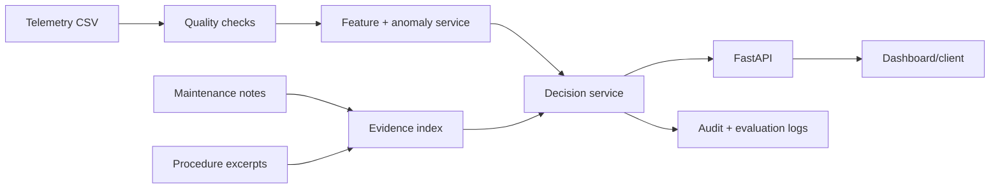

# Turbine Maintenance Intelligence Copilot

> A reproducible, evidence-grounded AI engineering project for turbine maintenance teams.

This project turns a maintenance question into a traceable decision-support response by combining **asset telemetry**, **maintenance history**, and **engineering procedures**. It is deliberately designed as a small production system rather than a notebook-only model.

The project is inspired by my exposure to turbine maintenance workflows during a summer training assignment at NTPC. The public repository uses **synthetic telemetry and authored procedure excerpts**. It does not contain confidential plant data, real operator names, or real maintenance instructions.

## What it does

Given an asset and time window, the service:

1. validates and profiles telemetry;
2. detects abnormal temperature/vibration behavior with an interpretable rolling z-score baseline;
3. retrieves relevant maintenance evidence using a transparent lexical retriever;
4. produces a structured recommendation with evidence IDs, uncertainty, and a human-review decision;
5. logs enough metadata to evaluate latency, retrieval quality, abstentions, and data quality.

Example response:

```json
{
  "asset_id": "LP-BRG-02",
  "status": "review_required",
  "finding": "Bearing temperature is outside its recent operating envelope.",
  "recommended_action": "Inspect lubrication flow and verify the bearing temperature sensor before returning the unit to normal service.",
  "confidence": 0.82,
  "evidence": ["PROC-LUBE-001", "WORK-2026-014"],
  "limitations": ["No vibration channel was available in the requested window."],
  "human_review_required": true
}
```

## Why this is not a generic chatbot

The answer is constrained by a real workflow: **trend → anomaly → retrieved procedure → bounded recommendation → human review**. The system abstains when telemetry is stale, evidence is weak, or a safety-sensitive conclusion cannot be supported. It never claims to issue a work order or replace an engineer.

## Architecture



## Quickstart

```bash
python3 -m venv .venv
source .venv/bin/activate
pip install -e '.[dev]'
python scripts/generate_demo_data.py
python scripts/run_evaluation.py
python -m uvicorn turbine_copilot.api:app --reload
```

Then open `http://127.0.0.1:8000/docs`.

Without installing the optional test package, the core demo still runs with the runtime dependencies:

```bash
python scripts/generate_demo_data.py
python scripts/run_evaluation.py
```

## API examples

```bash
curl 'http://127.0.0.1:8000/health'
curl 'http://127.0.0.1:8000/assets/LP-BRG-02/diagnosis?hours=24'
curl 'http://127.0.0.1:8000/quality/telemetry'
```

## Evidence and results

The reproducible evaluation is stored in [`reports/evaluation.json`](reports/evaluation.json). It covers:

- anomaly detection precision/recall on labelled synthetic windows;
- evidence retrieval hit rate;
- structured response validity;
- abstention behavior for missing vibration data;
- data-quality rule outcomes;
- p50/p95 diagnosis latency.

The result is intentionally reported with limitations. Synthetic telemetry is useful for pipeline validation, but it cannot establish plant-level failure thresholds.

## Development story

The Git history is part of the project evidence:

1. **Scaffold and reproducible data contract**
2. **First diagnosis prototype**
3. **A failing boundary test exposed a timestamp-window bug**
4. **The window-selection bug was fixed and the regression test retained**
5. **Evaluation, API validation, audit logging, and documentation were added**

The failed test is a real intermediate development state reproduced by the commit history, not a fabricated “bug museum.” The final branch is green and the failure is explained in [`docs/debugging-timestamp-window.md`](docs/debugging-timestamp-window.md).

## Safety and limitations

- Synthetic data only; no confidential NTPC or HCLTech data is included.
- This is decision support, not an autonomous maintenance or control system.
- Thresholds are illustrative and must be calibrated with domain experts.
- Lexical retrieval is intentionally transparent. A production version would compare it with embedding retrieval and a reranker.
- A real deployment would require IAM, secret management, network controls, approval workflows, and plant historian integration.

## Skills demonstrated

Python, pandas, NumPy, SQL-style data quality thinking, time-series feature engineering, anomaly detection, information retrieval, structured outputs, FastAPI, testing, logging, API design, evaluation, responsible AI, reproducibility, Git/GitHub, and production-minded documentation.
